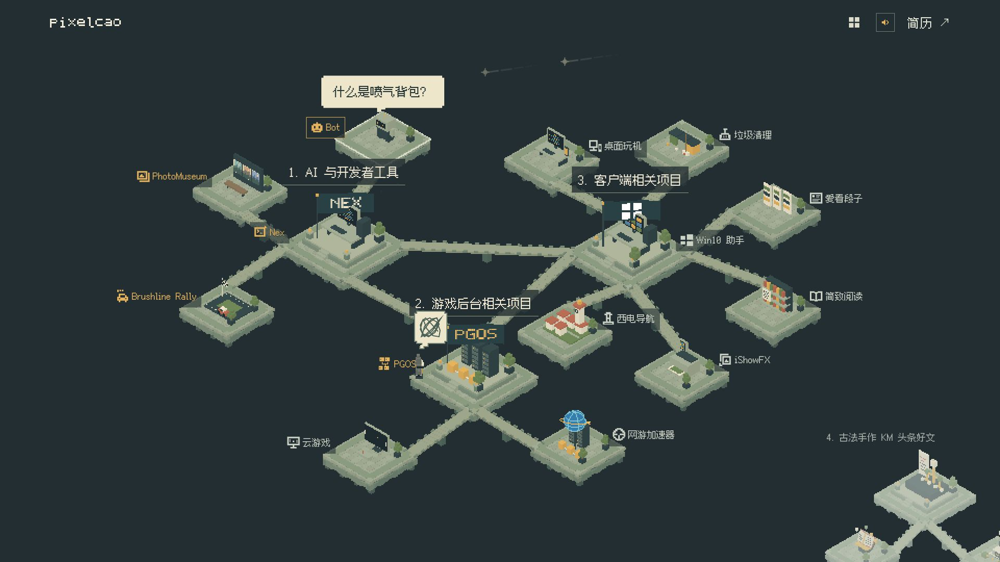

# pixelcao · 白帽旅人的像素微缩展馆



独立的静态作品站。Node.js 只负责本机文件服务；Three.js 实现正交像素世界、四组主题、分支桥梁与白帽旅人的最短路行走／施法。14 个项目展台、3 个 KM 文章岛，238 份去重素材。

## 运行

需要 Node.js 22 或以上版本。

```sh
cd cv_proj
npm ci
npm run build
npm start
```

打开 http://127.0.0.1:3000 。服务仅监听 127.0.0.1；修改端口用 `PORT=3001 npm start`。端口占用会直接报错。停止服务按 Ctrl+C。修改 `src/` 或 `public/` 后重新构建、刷新页面。

可把整个 `cv_proj/` 复制到任意位置运行，无需上级 Gallery、旧预览服务、FFmpeg、Python或 CDN。`dist/` 和 `node_modules/` 可删除后重建。依赖锁定 Three.js 0.186.1、esbuild 0.28.2。

## 浏览

- 首屏围绕原有三组主岛居中取景：AI 与开发者工具（Nex）、游戏后台相关项目（PGOS）、客户端相关项目（Win10 助手），右下角独立的「古法手作 KM 头条好文」以灰白遮罩预览略微出画，不参与主岛取景。点击预览展开岛群，之后点击文章展台进入详情；点击主题名只移动镜头。
- 点击“全景”或在闲置时按 Escape 回到整张地图。返回全景／切换主题会取消未完成访问，旅人留在实际位置。
- 主题内左右箭头、方向键浏览所属项目；拖拽平移镜头，滚轮缩放，均不打开详情。年份保留在详情中。
- 点击展台、项目标牌、左侧标题或“查看项目”：旅人沿桥梁网络的最短路径行走，到达后施法，金色方框展开为详情。关闭后留在原展台。
- 最远单程步行约 6.12 秒；施法 1.05 秒、门框展开 0.42 秒。连续改选以最新目标为准，从当前实际位置转向。
- 行走中手动拖动或滚动镜头会暂停跟随，下次主动访问恢复。Escape 可取消行走或施法，停留在当前路径位置。
- 单图显示大图；多份素材在两列瀑布流中按原比例展示，懒加载图片。点图放大，可用方向键继续浏览。
- 视频进入详情／滚动进入可见区域后自动静音播放，原生控件可开启声音、拖动进度。移出可见区域、切换、放大其他素材或关闭详情会停止原视频。
- 详情内 Escape 优先关闭大图，再关闭详情。关闭后恢复焦点；浏览器前进／后退和 `/#project=cloudgame` 等深链接可用。
- 尊重系统减少动态效果设置；`?motion=reduce` 可验证即时切换。`?renderer=flat` 可验证无 WebGL 的平面项目导航降级。
- `/resume/` 是独立 HTML 简历，PhotoMuseum 与 Brushline Rally 作为「Vibe Coding 作品」在工作项目经历前展示，包含图片和大图依赖。本轮没有重新导出 PDF。

## 目录

- `src/`：页面、样式、状态交互、Three.js 场景和自绘点阵字形。
- `public/data/portfolio.json`：访客内容，只包含站内展示／预览／原件 URL 与稳定素材 ID。
- `public/media/`：原件（按图片／视频／文档）、兼容视频、预览图和封面。
- `public/resume/`：独立 HTML 简历及资源。
- `design/`：历次概念图、C 方案、旅人关键帧、来源清单、许可。不会发布到 dist。
- `scripts/`：构建、验证、一次性迁移和可选媒体审计。
- `evidence/`：验收记录与真实浏览器截图，不进入 dist。
- `server.mjs`：仅提供 dist，支持 GET、HEAD、单段 Range，拒绝目录穿越和目录列表。

## 资源与验证

```sh
npm run check
npm run build
npm test
```

`check` 验证项目／素材数量、站内引用和 238 个原件 SHA-256。`test` 验证路线连续性、14 个目的地、长途速度、取消／改选／重复目标／即时定位，以及 HTTP 类型、HEAD、视频 Range、无效范围、404、源码不可访问和路径边界。

`import-assets.py /absolute/source/repo` 是一次性导入工具，不参与日常构建。只有重新导入旧视频时需要 FFmpeg；`inspect-media.py` 是可选媒体解码审计，需要 Pillow 和 ffprobe。已准备的兼容视频使用 H.264/AAC；原本兼容的视频保留，HEVC 转码最大边 1920。全部原件留存在站内目录。

来源／排除记录见 `design/source-ledger.json`：重复素材、ZIP、副本、账号截图、待归属素材、空文件和 JS 黑洞不进入访客资源。云游戏天梯为 2019 年；西电导航为大学毕业项目，未虚构年份。Nex 的 1024 × JEV 补充演示沿用既有档案归属，其具体关联仍待核对。

本项目沿用上级仓库的本地 Git；没有嵌套仓库、在线发布或业务数据库。本轮验收见 `evidence/islands/validation.md`；之前的长路径版本保存在 Git 提交 `94f80b2`，其验收见 `evidence/traveler/validation.md`。

## 场景模块

- `src/world.js`：四个主题、14 个可行走项目和 3 个独立文章岛位置、岛台周边步道、桥梁图与 Dijkstra 最短路。角色在桥中途改选时以当前边的实际位置重新求路。桥面几何与角色移动共用一份路径数据。
- `src/models.js`：原创分部件旅人、17 种展品模型与静态方块实例化。分面颜色直接着色，无金属／清漆／反射。
- `src/exhibition.js`：低分辨率场景缓冲、正交镜头、射线点击、行走步态、施法方框、全景／主题自适应取景、背景色阶衰减与视锥剔除；仅通过回调通知详情层。
- `src/app.js`：浏览焦点、详情、媒体、历史、键盘与焦点恢复。
- `src/bridge-state.js`／`src/rising-bridges.js`：临时捷径石阶的升降状态、落脚检查和像素渲染。

动画状态为 idle → walking → casting → opening → detail → closing → idle。旅程 token 在改选／取消时递增，唯一 RAF 驱动当前旅程，避免异步旧目标回调。页面隐藏时暂停，恢复时不补算离开期间的时间。低分辨率只作用于三维场景，中文与项目原始素材保持原清晰度。

主题分组与摆放集中在 `src/world.js`。`node scripts/render-layout.mjs` 可从同一份配置重新生成设计拓扑图和全部 196 对项目的距离记录。新的概念图、原始提示词保存在 `design/islands/`，不进入访客资源。

### 浮升石阶捷径

Bot ↔ 桌面玩机、Brushline Rally ↔ 云游戏、网游加速器 ↔ iShowFX 共三条双向捷径加入原有最短路径图，按实际距离选择；主展馆原有 14 座常驻桥不变，KM 岛群内两座石桥仅连接文章展台，不接入主角的可达区域。只有当前路线经过该捷径、且旅人接近入口时，石块才从下方依次升起，完全对齐后才能通行。身后石块逐块下沉淡出。桥上取消会留下脚下的一小段平台；改选从实际位置重新寻路，需要时重新升起已退场的石块。等待期间停止步态和脚步声；通行时镜头取景兼顾桥梁两端，跨主题两端项目可继续访问。

减少动态效果和深链接直接定位、打开详情，不重播架桥。44 项测试覆盖全部 196 对起终点、双向通行、未选中捷径不显形、支撑检查、取消、反向和连续改选。设计稿保存在 `design/void-bridges/`，实机采样、关键帧及距离对比在 `evidence/void-bridges/`。

## 界面字体

作品站的全部界面文字使用方舟像素 Ark Pixel 12px 简体中文比例版（2026.10.25），包括段落、贡献列表和个人简介；pixelcao 保留自绘字标。项目标牌采用 18px 字号与左侧原创像素 SVG，正文主要为 16–20px，不模拟粗体。密集标牌保持就近摆放并进行碰撞避让。字体与 OFL 1.1 许可证位于 `public/fonts/ark-pixel/`，完整自托管，无 CDN。来源与 SHA-256、当前所有项目标题/年份/导航文字的无缺字核对见 `design/typography/`。

## 展馆地标与聚光

三大主题按 1/2/3 编号，NEX 与 PGOS 为实体像素字块立牌，Win10 为蓝色四窗格立体徽标。首次主动访问先用 0.65 秒聚光引导旅人，随后跟随步行和施法；取消或进入详情后退出，减少动态效果时跳过。验收见 `evidence/landmarks/validation.md`。背景候选及内置 ImageGen 提示词见 `design/background-directions/index.html`，背景方案尚未替换到站点。

### 声音

首次访问默认开启声音，尝试直接播放原创合成钢琴 BGM；若浏览器阻止自动播放，首次点击或键盘确认时开始播放，无需另按声音开关。等待浏览器解锁仍显示为已启用；开关可直接静音，并记住用户主动选择。步幅同步的脚步和点按音效沿用同一开关。详情降低音乐音量；视频出声时 BGM 避让，页面进入后台时暂停。音频文件已包含在 `public/audio/`，正常构建不需要 FFmpeg。声音设计与验证见 `design/sound/README.md`。

### 小岛悬停

17 个展台各有独立循环；悬停岛面或项目名可预览，键盘聚焦也支持。赛车带引擎与鸣笛，Bot 带像素打字气泡和电子拟声，照片展片弯折旋转，Pong 持续对打，其他项目分别展示数据流、地图、菜单和翻页等动作。闲置时每 10–15 秒有少量像素流星，仅沿页面顶部 25% 区域的右上至左下对角线划过并逐渐淡出；详情、后台和减少动态效果时暂停。动作清单与验证记录见 `design/island-hover/README.md`。

### 字标闲置动画

闲置 5 秒后，pixelcao 的 8 个字母依次进行像素格阶梯跳动，每轮 1.44 秒、开始间隔 5 秒，结束全部归位。鼠标、触摸、键盘或滚动操作立即打断并重新计时；后台、打开详情／简介及减少动态效果时不启动。

### 旅人待机动作

角色静止且在画面内时，每隔 10 秒随机播放一个小动作：展开双手原地转一圈（3.2 秒）、挠头并出现动态乱线思考气泡（3.6 秒）、摘帽端详再戴回（4 秒）。动作采用随机抽签、不连续重复；结束回到站姿，脚下世界坐标不变。气泡只绘制像素线条，约 8 帧／秒，无文字、无新增音效。行走、施法、详情／简介、拖动画面、页面隐藏或减少动态效果会取消动作并重新计时。帽子始终属于角色骨架，调整旋转轴时保持原站姿外观。

实现位于 `src/traveler-idle.js`，实机关键帧、三动作采样回放和验证记录位于 `evidence/traveler-idle/`。

### 项目详情

14 个项目统一使用图标、小标题和短段落，分节保存在项目数据的 `workflow` 字段，单节可指定 `icon`。原始 `contributions` 保留为内容依据；展示时避免重复列出。简短项目保持单节，不重复显示同义摘要。桌面保留双栏媒体与文字；手机多素材项目先介绍、后素材，单素材项目保留原来的图文顺序。

主题视图在“查看项目”下方列出同一份 `workflow` 的图标与小节标题，手机采用两列。点击详情空白处返回原视图；详情和主要项目画廊的全屏图片也可点击空白处返回，图片本体、文字、按钮、滚动条和拖动操作不会触发返回。悬停小岛底部每秒产生约 6 枚白色像素碎屑，向下飘落后消失；减少动态效果时关闭。沙沙脚步音量在原增益基础上降低 30%。验证见 `evidence/island-refinements/validation.md`。

### 访问道具音效

旅人到达并展开金色边框时播放一次原创 RPG 道具琶音（0.88 秒）。沿用总声音开关，取消／改选和后台停止，静音事件不补播；深链接和减少动态效果的即时打开不触发。试听文件位于 `design/sound/item-chime-preview.wav`，验证记录见 `evidence/item-chime/`。

### 主要项目画廊

页眉“项目画廊”打开全屏 `#gallery`，只展示 7 个主要项目，以纵向时间轴和独立横向图片带呈现时间范围、项目标题、职业技能和最多 10 张插图。选图及展示日期保存在 `public/data/gallery.json`；图片可放大，标题可进入原有详情并返回阅读位置。原件仍使用既有素材地址。画廊共 50 张插图，其中 45 张派生图片位于 `public/media/gallery/`，另 5 张直接复用项目原图。派生来源记录在 `design/gallery-stills.json`。验证见 `evidence/major-gallery/`。

### 全景项目标题

桌面全景显示主馆 14 个项目标题，Nex／PGOS／Bot／Brushline Rally／PhotoMuseum 标黄，其余灰白；悬停岛台、标题或键盘聚焦时显示矩形边框。手机全景只显示 1／2／3／4 主题标题，展开主题后显示项目标题，悬停和键盘聚焦不会让项目标题挤入全景。四号 KM 群仍以独立预览邀请进入。验证记录位于 `evidence/overview-titles/` 和 `evidence/mobile-labels-2026-10-31/`。

## KM 文章岛

「4. 古法手作 KM 头条好文」位于全景右下方，与主展馆没有物理连接。默认以略微超出右下边缘的缩小预览展示，48% 灰白遮罩仅覆盖文章岛表面；主镜头只框选原有 14 个项目，不受文章岛位置影响。点击预览后，平滑恢复展台比例、移除遮罩并展开该主题。编译原理、Bot 与 NLP、网络与 NAT 三个文章岛分别收纳 1、3、1 篇代表文章，雕塑分别表现编译语法树、魔法书与词向量、NAT 网关。展开后点击文章展台直接阅读简洁的文章卡片，旅人留在主馆原处，不行走、不施法、不瞬移。深链接、前进后退、关闭和无 WebGL 降级同样遵守这条规则。

`public/data/portfolio.json` 的 `articles` 集中保存五篇文章的标题、KM URL、日期与截图素材 ID；项目和文章岛只引用 ID，复用同一张截图。PGOS、Bot、网游加速器的详情素材区优先展示各自文章卡片，照片仍按原顺序排列。卡片整体可点击，在新标签页打开 KM。`km.woa.com` 为用户指定的内网目的地；未抓取文章正文、未检验外网可达性，也没有根据标题推断文章成果。验收见 `evidence/km-articles/validation.md`。

四号岛群折叠预览的尺寸、遮罩、展开／收回与手机验证见 `evidence/archive-preview/validation.md`。

## 手机地图交互

竖屏默认以更近的视角显示主岛，可从岛面、项目名或空白处直接拖动。双指捏合以手指中心缩放，抬起一根手指后可以继续单指拖动；底部提供放大／缩小按钮。拖动直接跟随输入，主题切换的缓动可随时接手。

放大浏览时，可直接点击可见的其他主题项目，旅人从当前实际位置重新求最短路径，不必先返回全景。四号 KM 群依旧独立，仅展开／查看文章，旅人不能过去。

手机介绍区采用紧凑标题与查看按钮，技能标题为单行横滑；地图和标牌限制在介绍区下方。页眉、返回、缩放、项目标牌和详情关闭的主要触摸目标均至少 44 像素高。底部返回可随时恢复默认取景。四号预览避开底部操作区，保持灰白遮罩与边缘裁切。

开场动画期间只显示底部“跳过”，隐藏缩放与项目切换按钮，结束或跳过后恢复。手机图片预览的前后按钮与原图入口也至少 44 像素，原图入口有独立底部空间。无 WebGL 的手机全景同样只保留四个主题入口。

手机 3D 画布按屏幕密度渲染，最高 2 倍、总像素不超过 150 万；桌面保留半分辨率的像素画面。模型、贴图的像素造型不变，手机通过增加采样保留台阶、雕塑和旗帜细节；拖动和缩放过程中不降低分辨率。对比截图与验证见 `evidence/mobile-resolution-2026-10-31/validation.md`。

复现问题的历史记录见 `evidence/mobile-portrait-review-2026-10-31/`，修复验收见 `evidence/mobile-touch-fix-2026-10-31/validation.md`。双指状态机与缩放几何已测试；桌面竖屏视口已复测点击、拖动与缩放按钮，尚未使用实体手机验证 Safari 帧率、发热与真实双指手感。

## 首屏加载进度

加载界面的样式、白帽旅人图标和启动代码直接内联到构建后的 HTML，不依赖外部字体、CSS 或主脚本才能显示。手机和桌面只显示白帽旅人、pixelcao 字标和金色进度条；读取资源时更新真实下载字节进度，首帧绘制完成后进入页面。照片、视频和 BGM 继续按需加载，不计入首次进入的等待。

构建自动记录主脚本、样式、两份数据及字体的大小和版本标识。启动器复用已下载数据和字体，不重复获取。加载阶段、百分比和慢速提示仅通过无障碍语义提供，不显示文案；关键资源失败或 45 秒未完成时显示重试与简历图标按钮，不伪装成 100%。字体缺失时使用后备字体。键盘和屏幕阅读器在加载期间只接触加载界面，减少动态效果时关闭淡出动画。验证与慢速加载截图见 `evidence/loading-2026-10-31/validation.md`。
