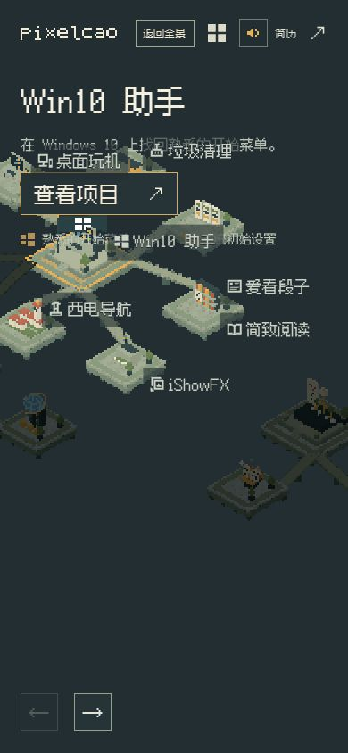

# 竖屏手机体验评估：问题梳理，尚未制定修复方案

日期：2026-10-31。评估版本：本地提交 `fd753f6`，服务为 `http://127.0.0.1:3000/`。本轮没有修改产品代码、构建、提交或推送。

## 结论

当前竖屏页面可以完成浏览和访问项目，视觉风格成立，但连续探索地图的导航成本偏高。影响舒适性的主要因素是跨主题点击限制、拖动起手不一致、拖动后信息遮挡，以及缺少手机手势缩放。现阶段更适合观赏式访问，尚不能说是顺手的触屏地图。

## 测试范围与证据边界

- 实际操作了 375×667、390×844、430×932 三种竖屏视口，使用常规动画模式，执行点击、单指等效指针拖动、主题切换、旅人访问、详情关闭和同组箭头浏览。
- 运行环境是桌面内嵌浏览器的竖屏视口，并非实体手机。工具只提供单指等效点击／拖动，不提供真实双指捏合、移动设备仿真或真机帧率测量。
- 下文明确区分实测、代码确认和体验判断。没有把桌面鼠标拖动当成完整触屏验证，也没有声称验证过手机 Safari 的性能。
- 本次浏览器控制台没有记录警告或错误；没有出现页面横向滚动或浏览路径完全失效。

## 一、放大后能否直接点击其他小岛

**同一主题内可以；普通放大浏览状态下，跨主题不可以。**

实测：

1. 390×844，全景点击「1. AI 与开发者工具」。
2. 点击 Bot 岛面，当前项目从 Nex 变为 Bot，阶段变为 `walking`，旅人开始移动，随后自动打开 Bot 项目详情。同组小岛可以直接访问。
3. 重新进入 AI 主题，把地图向左上拖，让 PGOS 的整座平台显示在右下。
4. 点击可见的 PGOS 平台（该次坐标约 285,605），当前项目仍为 Nex，主题仍为 AI，阶段仍为 `idle`；没有切换、行走、详情或提示。

因此，常规跨主题访问需要先点真正的空白处或顶部「返回全景」，再点其他主题／项目。不是只能点空白处，但确实需要经过全景。底部左右箭头只浏览当前主题，无法绕开这个限制。

此外，并非所有看起来空的地方都会返回：石桥和其他主题的岛面都不算空白，点这些区域可能什么都不发生。

代码确认：`src/exhibition.js:180` 将可拾取岛屿限定为当前主题；`181` 与 `190` 又排除岛屿／桥梁上的空白返回。例外是旅人正在走浮升捷径时，已经启用的桥梁端点可以临时加入可访问范围；这不等于普通浏览时支持跨主题直达。四号 KM 群仍按既定设计不允许旅人过去。

证据：[拖动后可见但点不动的 PGOS](ai-pan-neighbor-390.jpg)。

## 二、拖动起手不一致，松手后也有缓动尾巴

- **岛面或纯空白起手可以拖。** 在客户端主题，从 iShowFX 岛面起手拖动后，Win10 标牌从约 `(190,491)` 移到 `(110,397)`，项目仍是 Win10，未误触发访问。
- **项目标题起手不可以拖。** 在 AI 主题，拖动 Nex 标牌约 100×80 像素，标牌位置前后完全相同，项目也没有变化；客户端主题的 iShowFX 标题也出现相同行为。
- **松手后镜头继续追赶。** 岛面拖动释放时，数据仍为 `cameraReady=false`，随后才停稳。体验上更像把镜头带走，而非地图严格跟着手指移动。

代码确认：地图拖动仅绑定在 Canvas，项目名是独立 HTML 按钮；镜头采用持续插值。单指等效操作已复现这种差异，真实手指起手时的点击／拖动取消细节仍需真机补测。

## 三、拖动能把小岛和标牌带进固定简介区

390×844，客户端主题连续向上拖动后：

- 固定简介区底部约为 y=278。
- 桌面玩机和垃圾清理标牌分别进入约 y=162、y=151；Win10 标牌进入约 y=252。
- 标牌和模型与摘要、技能小标题、「查看项目」按钮互相叠压，部分岛屿还被拖出屏幕边缘。

这会同时损害阅读和命中判断：手指落在文字与岛面重叠的位置时，难以判断会点中哪一层。

证据：

## 四、缩放有缓动，但连续操作会被锁住；手机缺少手势缩放支持

实测：

- 全景进入 AI 主题时，镜头尚未停稳的阶段，所有可见项目标牌均为 `disabled`。
- 一次从主题点击到 `cameraReady=true` 的桌面模拟过程约 2.04 秒，包含自动化调用开销；这个数值不能当成真机耗时或帧率指标。
- 普通缩放切换没有跳到错误主题，已有连续缓动机制；问题主要是过渡期间地图拖动和小岛点击不接收，连续探索会显得没有响应。

代码确认：`src/exhibition.js:184` 在浏览过渡期忽略地图按下；标牌在过渡期禁用。相机使用相同插值追赶目标，解释了拖动释放后的尾巴。

**手势支持缺口：**缩放只看到 `wheel` 处理，没有双指距离、双指中心或多指状态管理；地图 CSS 的 `touch-action` 实测为 `none`。没有应用层双指捏合，也不能依赖地图区域的默认浏览器手势替代。这是代码确认，不是本轮真机捏合实测。

## 五、触摸目标偏小，窄屏页眉退化

390×844 的实际命中框尺寸：

- 返回全景约 66×31；项目画廊和声音按钮均为 32×32。
- 简历链接约 58×24；项目标牌高度约 39。
- 详情关闭按钮仅 28×28，而且在屏幕顶部。
- 左下前后按钮约 42×42，位置和面积相对容易操作。

375×667 的放大视图中，页眉更拥挤：「返回全景」换成两行，「简历」也出现分行，控件间距和视觉秩序下降。鼠标可以精确点中，但由尺寸与位置判断，单手指腹的容错较低，顶部操作也需要上探。这里是基于测量的舒适性判断，不是实体手机手掌测试。

证据：[375×667 页眉与放大视图](rally-focused-375.jpg)。

## 六、全景像缩略地图，短屏放大后仍比较局促

- 390×844，全景的实体岛群主要集中在屏幕中间约一小段高度，上下留白很多；主题名入口仍可点，但多数岛面太小，多个普通项目名默认不显示。
- 375×667，Brushline Rally 简介区本身约高 268 像素，四个 AI 岛屿主要挤在下方约 y=400～570 的区域。岛名还可能因避让而离开所属模型，需要重新对照。
- 430×932 的 PGOS 三岛布局明显宽松，说明问题随视口与岛群数量、简介高度变化，并非所有放大视图都同样难用。

证据：[390 全景](overview-390.jpg)、[375 短屏放大](rally-focused-375.jpg)、[430 PGOS 放大](games-focused-430.jpg)。

## 已经可用的部分

- 主题入口、同组岛屿访问、旅人行走、自动打开详情、关闭后回到地图均能完成。
- 同组前后箭头可以只切换浏览项目，不启动长途访问；但它们不会跨主题。
- 详情在手机上按单列顺序阅读，纵向滚动可用。Bot 素材很多，页面很长，这是内容量造成，不能直接视为滚动故障。
- KM 预览的整块点击区较大，展开后再点文章的规则可用。

## 尚未验证

实体手机双指操作、iOS Safari／Android 浏览器帧率与发热、系统边缘手势和动态地址栏、安全区、真实指腹误触率。

本轮停在问题确认阶段：以上没有包含修复设计、技术方案或代码改动。
